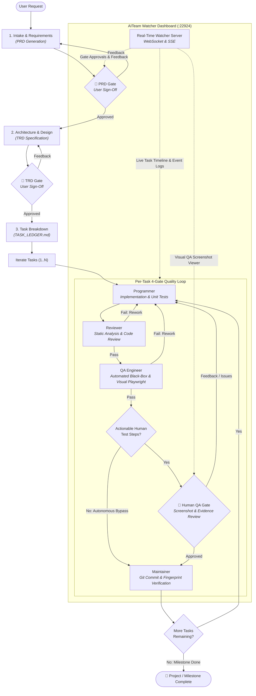

# AITeam

A lightweight, skill-based agentic software engineering team for AI coding environments (Antigravity, Gemini CLI, Claude, Codex, Copilot, Qwen).

AITeam coordinates an automated development workflow through structured quality gates—from PRD intake and task breakdown to implementation, code review, black-box QA, and git integration—while streaming live progress to a local dashboard.



---

## Features

- **Lightweight & Skill-Native**: Zero heavy runtime dependencies. Operates as an agent skill (`SKILL.md`) with explicit prompt contracts in `skill/contracts/`.
- **Structured Quality Gates & Intelligent Sign-Off**: Hard stops for PRD, TRD, and per-task QA sign-offs enforced by the state bridge (`AITEAM_GATE_BLOCKED`). Includes autonomous bypass for headless/internal tasks where manual verification is non-actionable, while preserving full automated QA.
- **4-Gate Quality Loop**: Every task strictly passes Implementation, static Code Review, automated black-box QA, QA sign-off, and SHA-256 verified Git integration.
- **Visual QA Screenshot Evidence**: Black-box and Playwright visual verification screenshots are automatically cataloged, linked, and displayed directly inside test reports and the Watcher UI.
- **Real-Time Live Dashboard**: Lightweight HTTP/WebSocket watcher server (`bin/aiteam-watch`) visualizing task status, active logs, phase progress, gate prompts/approvals, visual screenshot evidence, and generated artifacts in your browser.
- **Brownfield Safety**: Automatically archives existing PRD and TRD documents when starting new milestone iterations to preserve prior project specifications.
- **State Bridge**: Clean CLI & programmatic bridge (`skill/lib/state-bridge.mjs`) tracking `.aiteam/session.json` and `.aiteam/events.jsonl` without process locks or daemon overhead.

---

## Installation

### 1. Install CLI Launchers

On Linux / macOS:
```bash
./install.sh
```

On Windows (PowerShell):
```powershell
.\install.ps1
```

This installs `aiteam-watch` and `aiteam-install` into `~/.local/bin`.

### 2. Install AITeam Skill into Any Project

To enable AITeam in a target project:
```bash
aiteam-install /path/to/target-repo
```

This sets up:
- `.agents/skills/aiteam`: Symlinked or copied skill directory containing `SKILL.md` and contracts.
- `.aiteam/`: Run and artifact directory (automatically excluded in `.git/info/exclude`).
- `AGENTS.md`: Quick-trigger agent prompt instructions.

---

## Usage

### 1. Start the Live Watcher Dashboard
Run the dashboard in the target project repository:
```bash
aiteam-watch . --port 22924
```
Open `http://localhost:22924` in your browser.

### 2. Trigger the Workflow
In your AI assistant prompt (or conversation), say:
> "Using AITeam, I want to build `<feature/project>`"

Or if resuming an existing workflow:
> "resume aiteam"

The coordinator agent will activate `aiteam` skill, consult `.aiteam/session.json`, execute the required gates, and log progress to `.aiteam/`.

---

## Directory Structure

```
.
├── bin/
│   ├── aiteam-install       # Shell installer linking skill into target projects
│   ├── aiteam-watch         # Live progress watcher launcher (bash)
│   ├── aiteam-watch.cmd     # Windows cmd launcher
│   └── aiteam-watch.ps1     # Windows PowerShell launcher
├── skill/
│   ├── SKILL.md             # Skill definition and coordinator instructions
│   ├── contracts/           # Role prompt contracts (programmer, reviewer, qa, maintainer)
│   ├── lib/
│   │   ├── state-bridge.mjs # State & event persistence bridge for .aiteam/
│   │   ├── runner-adapter.mjs # Subprocess CLI adapter (if dispatching external CLIs)
│   │   └── fingerprint.mjs  # SHA-256 change fingerprinting
│   └── templates/
│       └── AGENTS.skill.md  # Template instructions for target repositories
├── src/
│   ├── watch-server.mjs     # Standalone HTTP dashboard server
│   └── watch-dashboard.html # Single-page live progress UI
└── test/
    ├── skill-integration.test.mjs # Skill state-bridge & dashboard tests
    └── watch-server.test.mjs      # Dashboard server tests
```

---

## Testing

Run the test suite:
```bash
npm test
```
